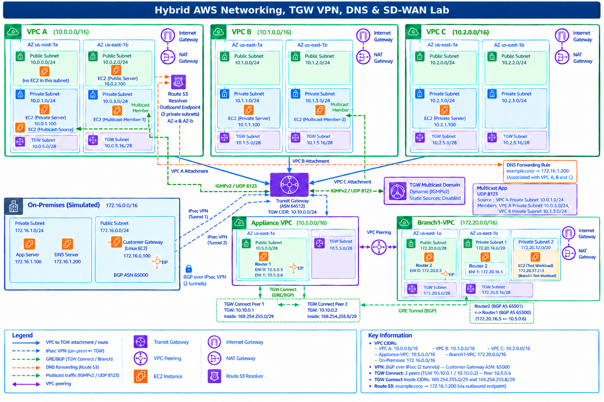
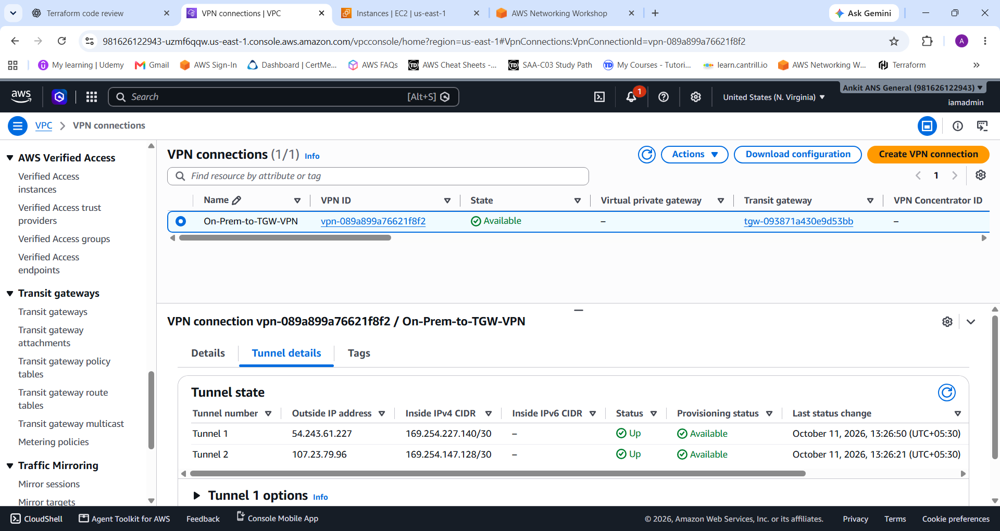
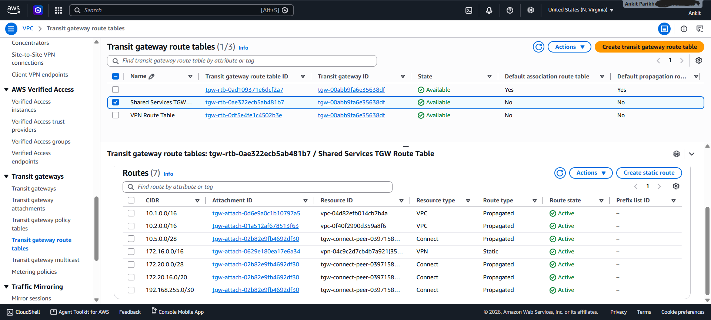
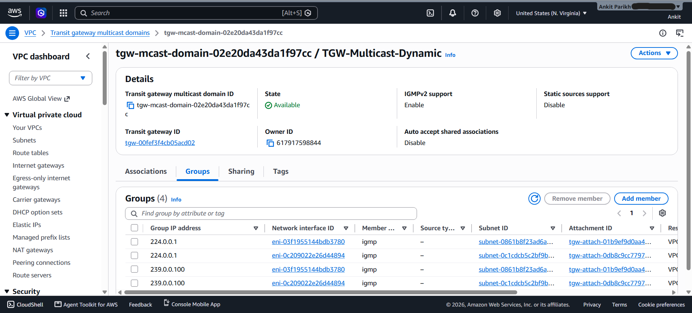
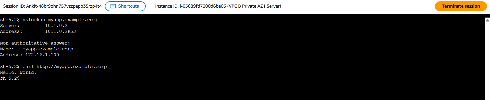
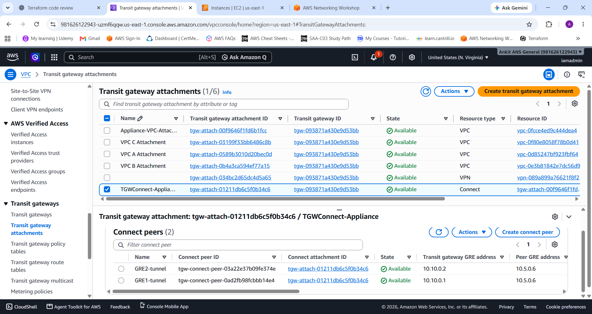

# Enterprise Hybrid Cloud & SD-WAN Interconnect with AWS Multicast Architecture & Hybrid DNS Architecture

## Project Objective
To architect and deploy an enterprise-grade hybrid cloud network bridging simulated on-premises infrastructure and third-party SD-WAN environments with multiple AWS VPCs. The project demonstrates advanced routing via AWS Transit Gateway, Site-to-Site VPNs with BGP, seamless SD-WAN appliance integration using GRE tunnels, centralized hybrid DNS resolution using Route 53 Resolver and the implementation of an AWS Multicast domain for high-throughput traffic distribution.

## Architecture Diagram	

## Technology Stack
* **Cloud Provider:** Amazon Web Services (AWS)
* **Infrastructure as Code (IaC):** Terraform (Modular design & automated provisioning)
* **Core Networking:** AWS Transit Gateway, VPC Peering, Subnetting, Route Tables
* **Hybrid Connectivity:** Site-to-Site IPsec VPN, Customer Gateways, BGP Routing
* **Advanced Routing:** Transit Gateway Multicast Domains, IGMP
* **Security:** Security Groups, Network Access Control Lists (NACLs)
* **Third-Party Integration:** SD-WAN Appliance Simulation, Transit Gateway Connect Attachment, GRE Tunnels, BGP Peering
* **Hybrid DNS & Name Resolution:** Amazon Route 53 Resolver (Endpoints, Conditional Forwarding Rules)

## Implementation Steps
1. **Infrastructure Automation:** Codified the entire hub-and-spoke deployment using Terraform for consistent, repeatable infrastructure provisioning.
2. **VPC Infrastructure:** Provisioned multiple VPCs across different Availability Zones with strict public/private subnet isolation.
3. **Hybrid Connectivity:** Established a Site-to-Site VPN connection, configuring a Customer Gateway and routing to simulate an on-premises network link.
4. **Transit Gateway Deployment:** Deployed a central Transit Gateway to act as a hub, attaching VPCs and the VPN connection, and configuring custom route tables for traffic isolation.
5. **SD-WAN Integration:** Provisioned a simulated third-party SD-WAN appliance (Linux/Openswan). Configured a Transit Gateway Connect attachment, establishing GRE tunnels and BGP peering for dynamic, high-bandwidth route exchange.
6. **Centralized Hybrid DNS Resolution:** Deployed Amazon Route 53 Resolver Outbound endpoints. Configured conditional forwarding rules to achieve seamless domain name resolution from AWS VPC to on-premises branch environments.
7. **Multicast Domain:** Configured a Transit Gateway Multicast domain, registering source and member instances, and validating IGMP traffic flow across cloud subnets.
8. **Operations Runbook:** Check out the [Day 2 Operations & Incident Response Guide](DAY2_OPERATIONS.md) for network health monitoring, scaling instructions, and troubleshooting runbooks.

## Proof of Validation
*Below are screenshots confirming the successful configuration and active routing of the hybrid network:*

